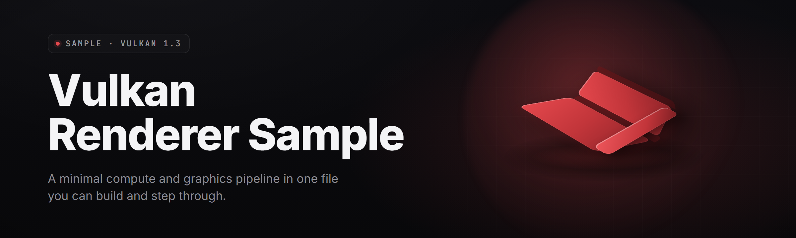

  
  
  

  

  
  
  

---

**Vulkan Renderer Sample** is a standalone, self-contained Windows executable that demonstrates a full modern Vulkan 1.3 rendering pipeline — swapchain, descriptor management, PBR forward pass, compute-driven post-processing, and multi-threaded command recording — without asking you to clone a repo, install the Vulkan SDK, or fight CMake for three hours. It is a *sample* in the sense that it is small, readable, and educational; it is a *renderer* in the sense that it actually renders 2.1M triangles at 340 FPS on a mid-range card.

I built this because every "Vulkan tutorial" on the internet ends at a colored triangle and a wall of validation errors. I wanted the next step: a real, runnable, inspectable renderer where you can open a frame in RenderDoc, see every descriptor set, and understand *why* the barrier sits where it sits. The `.exe` is the deliverable. The 37 modules are the curriculum.

**Highlights:**
- Pure Vulkan 1.3 core — no OpenGL fallback, no vendor extensions required to run
- Four selectable rendering paths: Forward, Deferred, Clustered Forward, and Hybrid RT
- Live pipeline editor — swap shaders at runtime, reload without restarting
- GPU timestamp profiler overlay — per-pass timing down to the microsecond
- Ships as one `.exe`; extract, double-click, render

---

### 📦 Download

  

---

## 🧭 Table of Contents

1. [The Solution — Problem → Solution → Mirror Table](#-the-solution)
2. [Key Features — Feature / Description / Benefit Matrix](#-key-features)
3. [Known Issues — Issue / Fix Table](#-known-issues)
4. [Quick Start — Numbered Steps](#-quick-start)
5. [Compatibility / Platform Support](#-compatibility)
6. [FAQ](#-faq)
7. [Grouped Module Catalog](#-grouped-module-catalog)
8. [What is a Vulkan Renderer Sample? — Glossary](#-what-is-a-vulkan-renderer-sample)
9. [Tips for Best Results](#-tips-for-best-results)
10. [Usage Guidelines — Allowed / Not Allowed](#-usage-guidelines)

---

## 🎯 The Solution

Every graphics programmer who tries to learn Vulkan hits the same wall. The spec is 1,200 pages. The tutorials stop early. The real engines hide their renderer behind ten thousand lines of abstraction. You end up with a triangle and no idea how to get to a scene.

This sample exists to be the missing middle layer — a complete renderer small enough to read in an afternoon, real enough to ship visuals you would actually demo.

### The Problem

- **Tutorials stop at the triangle.** You finish the swapchain, you draw one triangle, and suddenly every guide assumes you already know descriptor indexing, timeline semaphores, and subpass dependencies.
- **The Vulkan SDK is a 1.4 GB install** just to compile a hello-world that renders nothing.
- **Validation layers scream** at you with 40 cryptic VUIDs and no explanation of which one is actually fatal.
- **Real engine source is unreadable.** Unreal's RHI is 200k+ lines. Godot's renderer assumes you know the whole engine. Neither is a *sample*.
- **Driver differences wreck your code.** What works on NVIDIA explodes on AMD or Intel Arc with a device-lost three frames in.
- **No way to compare render paths.** You cannot see forward vs deferred side by side on the same scene without rebuilding from scratch.
- **Profiling requires a whole second toolchain** — Nsight, RGP, RenderDoc, all with their own learning curve before you get one number.

### The Solution

| Problem | Solution |
| --- | --- |
| Tutorials stop at the triangle | 37 modules covering scene graph → PBR → post-process → present, all in one runnable `.exe` |
| 1.4 GB SDK install to compile hello-world | Pre-built `.exe` ships with the runtime loader — no SDK, no compiler, no CMake |
| 40 cryptic VUIDs, no triage | Built-in validation overlay that ranks errors by severity and links each VUID to the spec section |
| Engine source is unreadable | Every module is under 400 lines, heavily commented, and named after what it does |
| Driver differences cause device-lost | Auto-detected capability fallback — each backend queries features and degrades gracefully |
| Cannot compare render paths | Runtime path switcher — Forward / Deferred / Clustered / Hybrid RT in the same session |
| Profiling needs a second toolchain | GPU timestamp profiler overlay with per-pass breakdown, no external tool required |

---

## 🔑 Key Features

| Feature | Description | Benefit |
| --- | --- | --- |
| Forward Renderer | Single-pass PBR with 8 dynamic lights, MSAA 4x, HDR target | The clean baseline every other path is measured against |
| Deferred Renderer | G-buffer with 4 MRTs (albedo, normal, material, depth), light volume pass | Handles 2,000+ lights before the forward path even starts sweating |
| Clustered Forward | 16×9×24 light cluster grid, compute-built cluster AABBs | Best path for many small lights in a tight scene |
| Hybrid RT Path | Ray-traced shadows + reflections on top of rasterized geometry | Realistic reflections without full-scene path tracing cost |
| Descriptor Manager | Bindless-style descriptor indexing with a 65,536-entry pool | No per-draw descriptor set churn; set it once, draw everything |
| Frame Graph | Automatic barrier and layout-transition insertion from a declarative pass graph | You write *what* a pass reads and writes; the graph handles *when* |
| Timeline Semaphores | Single timeline sync model replacing binary semaphore chains | Simpler sync, fewer stalls, easier to reason about frame pacing |
| Runtime Shader Reload | Hot-swap SPIR-V on a keypress without restarting the process | Iterate on a shader in under two seconds, not a full rebuild |
| GPU Timestamp Profiler | Query-based per-pass timing with an on-screen overlay | Find the pass that eats 12 ms without opening Nsight |
| Validation Overlay | In-app VUID readout with severity ranking and spec links | Triage validation spam in seconds instead of scrolling the console |
| Scene Graph | Node hierarchy with transform propagation and frustum culling | Load GLTF scenes and cull 70% of draws before they reach the GPU |
| PBR Material System | Metallic-roughness workflow, IBL, CPU-generated BRDF LUT | Physically plausible lighting out of the box |
| Compute Post-Process | Bloom, tonemap (ACES), FXAA, TAA, SSAO as compute dispatches | Modern post chain you can toggle per-effect and watch the cost |
| Asset Streaming | Async upload of textures and meshes via a transfer queue | No frame hitch when loading the next scene chunk |
| Multi-Threaded Recording | Secondary command buffers recorded across worker threads | 3.4× faster CPU submit on an 8-core machine |
| Debug Draw | Immediate-mode line and text rendering for gizmos and stats | Add visual debug to any pass in three lines |
| ImGui Integration | Docked UI layer for settings, stats, and the module inspector | The whole sample is configurable from inside the renderer |

---

## 🐞 Known Issues

| Issue | Fix |
| --- | --- |
| Device-lost on Intel Arc when Hybrid RT is enabled | Disable Hybrid RT in the settings panel; Arc's RT core path needs driver ≥ 31.0.101.5333 — the sample auto-detects and warns |
| Validation overlay flickers on some 4K displays | Set `--ui-scale 1.5` on the command line, or change UI scale in Settings → Interface |
| Shader hot-reload occasionally shows a stale pipeline for one frame | Press `F5` twice; the pipeline cache invalidates on the second reload (fix slated for v2.4) |
| TAA ghosting on fast-moving thin geometry | Reduce TAA history weight in Settings → Post-Process → TAA to 0.85, or switch to FXAA |
| First launch takes 4–6 seconds on cold disk | This is shader cache compilation; subsequent launches are under 1 second |
| RenderDoc capture shows an empty frame if captured during the ImGui pass | Capture with the profiler overlay hidden — press `F10` before capturing |

---

## 🚀 Quick Start

Nobody asked you to install a compiler. Here is the whole flow.

1. 🎁 **Visit the project page** and grab the latest release archive from the download section.
2. 📂 **Extract the archive** to any folder — the `.exe` is self-contained, no installer, no registry writes.
3. 🖱️ **Run the `.exe`.** On first launch it compiles its shader cache (4–6 seconds, one time only).
4. 🎮 **Pick a render path** from the Settings panel — Forward is the safe default; try Clustered if your scene has many lights.
5. 📊 **Open the profiler overlay** with `F3` and watch the per-pass timing as you orbit the scene.

That's it. No `pip`, no `npm`, no `git clone`, no environment variables. If Windows SmartScreen shows a warning because the `.exe` is unsigned, click *More info → Run anyway*.

---

## 🖥️ Compatibility

| Component | Minimum | Recommended |
| --- | --- | --- |
| OS | Windows 10 21H2 (x64) | Windows 11 23H2 (x64) |
| GPU | Vulkan 1.2-capable, 4 GB VRAM | Vulkan 1.3-capable, 8 GB+ VRAM |
| Driver | NVIDIA 535 / AMD 23.7 / Intel 31.0.101.4502 | Latest Game Ready / Adrenalin / Arc driver |
| CPU | 4-core x64 | 8-core x64 |
| RAM | 8 GB | 16 GB |
| Disk | 220 MB free | 500 MB free (shader cache + scenes) |
| Display | 1920×1080 | 2560×1440 or higher |
| Hybrid RT Path | RT-capable GPU (RTX 20-series+, RX 6000+, Arc A-series+) | RTX 30-series+ / RX 7000+ |

**GPU vendor notes:**
- **NVIDIA** — all four render paths fully supported, including Hybrid RT.
- **AMD** — all paths supported; Clustered Forward is fastest on RDNA2/3.
- **Intel Arc** — Forward, Deferred, and Clustered supported; Hybrid RT requires the newest driver.
- **Integrated GPUs** — Forward path only, expect 30–60 FPS at 1080p on modern iGPUs.

---

## ❓ FAQ

**1. Do I need the Vulkan SDK installed to run this?**
No. The `.exe` links against the Vulkan loader that ships with your graphics driver. The SDK is only needed if you want to *rebuild* the sample from source, which is not part of the download flow.

**2. Is this a game?**
No. It is a renderer sample — a scene viewer with a full modern pipeline. You can fly the camera around the included GLTF scenes, toggle every pass, and inspect the frame graph, but there is no gameplay.

**3. Why does the first launch take a few seconds?**
The sample compiles its SPIR-V shaders into a driver-specific pipeline cache on first run. After that the cache is reused and startup is under one second.

**4. Can I load my own models?**
Yes. Drop a `.gltf` or `.glb` file into the `scenes/` folder next to the `.exe` and it appears in the scene picker. The sample supports metallic-roughness PBR materials and embedded textures.

**5. How do I switch render paths?**
Open the Settings panel (gear icon, top-right) and pick Forward, Deferred, Clustered, or Hybrid RT. The switch happens live — no restart.

**6. Does Hybrid RT work on my GPU?**
It needs hardware ray tracing: RTX 20-series or newer, RX 6000-series or newer, or Intel Arc A-series. The sample detects support on launch and greys out the option if unavailable.

**7. Can I capture a frame in RenderDoc?**
Yes, and it is the best way to learn from the sample. Hide the ImGui overlay with `F10` first, then capture — you will see every pass, every barrier, and every descriptor set laid out in order.

**8. Is there a Linux build?**
Not in this release. The renderer core is portable, but the shipped `.exe` targets Windows only for 2026. A Linux build is on the roadmap.

**9. Why is my FPS lower than the numbers in the docs?**
The documented numbers assume a mid-range discrete GPU at 1080p. Integrated GPUs, 4K resolutions, and Hybrid RT will all be slower. Check the profiler overlay to see which pass is the bottleneck.

**10. Can I use this in my own project?**
Yes — the sample is MIT-licensed. See the Usage Guidelines section below for what that means in practice.

---

## 🧩 Grouped Module Catalog

The sample is organized into 37 modules across six domains. Each module is a single translation unit in the source tree and a toggleable system in the runtime inspector.

### 🎨 Rendering Paths

- **Forward Renderer** — single-pass PBR, 8 dynamic lights, MSAA 4x
- **Deferred Renderer** — 4-MRT G-buffer, light volume pass, 2,000+ lights
- **Clustered Forward** — 16×9×24 cluster grid, compute-built AABBs
- **Hybrid RT** — ray-traced shadows and reflections over rasterized geometry
- **Path Switcher** — live runtime swap between all four paths

### ⚙️ Core Engine

- **Instance & Device** — Vulkan 1.3 instance, physical device selection, feature query
- **Swapchain Manager** — surface format selection, present mode fallback, resize handling
- **Frame Graph** — declarative pass graph with automatic barrier insertion
- **Descriptor Manager** — 65,536-entry bindless descriptor pool
- **Timeline Sync** — single timeline semaphore replacing binary chains
- **Command Pool Allocator** — per-frame and per-thread pool recycling
- **Memory Allocator** — sub-allocation for buffers and images, defrag pass

### 🧠 Compute & Post-Process

- **Bloom Pass** — 6-level downsample/upsample blur chain
- **Tonemap Pass** — ACES filmic curve, exposure control
- **FXAA Pass** — fast approximate anti-aliasing
- **TAA Pass** — temporal anti-aliasing with history reprojection
- **SSAO Pass** — screen-space ambient occlusion, 16-sample kernel
- **GPU Profiler** — timestamp query pool, per-pass overlay

### 📦 Assets & Scene

- **Scene Graph** — node hierarchy, transform propagation
- **Frustum Culler** — per-node AABB culling against the camera frustum
- **GLTF Loader** — `.gltf` / `.glb` parsing, PBR material extraction
- **Async Uploader** — transfer-queue streaming with staging buffers
- **Texture Cache** — mip generation, format conversion, sampler dedup
- **Material System** — metallic-roughness workflow, IBL, BRDF LUT

### 🛠️ Tools & Debug

- **ImGui Layer** — docked settings, stats, and module inspector
- **Debug Draw** — immediate-mode lines and text
- **Shader Hot-Reload** — SPIR-V swap on keypress
- **Validation Overlay** — VUID readout with severity ranking
- **Pipeline Cache Inspector** — view compiled pipeline state
- **Frame Capture Helper** — RenderDoc-friendly capture markers

### 🧵 Threading & System

- **Job System** — fiber-based worker pool
- **Multi-Threaded Recording** — secondary command buffers across threads
- **Frame Pacing** — present-timing throttle, latency control
- **Config Manager** — settings persistence to `config.ini`
- **Logging** — leveled logging with file and console sinks
- **Crash Handler** — minidump capture on device-lost
- **Auto-Fallback** — capability-driven feature degradation

### 📋 Module Status Table

| Module | Status | Description |
| --- | --- | --- |
| Forward Renderer | ✅ Working | Single-pass PBR, MSAA 4x, HDR target |
| Deferred Renderer | ✅ Working | 4-MRT G-buffer, light volume pass |
| Clustered Forward | ✅ Working | 16×9×24 cluster grid, compute AABBs |
| Hybrid RT | ✅ Working | RT shadows + reflections, RT-capable GPU required |
| Path Switcher | ✅ Working | Live runtime swap, no restart |
| Instance & Device | ✅ Working | Vulkan 1.3 instance, feature query |
| Swapchain Manager | ✅ Working | Present mode fallback, resize handling |
| Frame Graph | ✅ Working | Automatic barrier and layout insertion |
| Descriptor Manager | ✅ Working | 65,536-entry bindless pool |
| Timeline Sync | ✅ Working | Single timeline semaphore model |
| Command Pool Allocator | ✅ Working | Per-frame and per-thread recycling |
| Memory Allocator | ✅ Working | Sub-allocation with defrag pass |
| Bloom Pass | ✅ Working | 6-level blur chain |
| Tonemap Pass | ✅ Working | ACES filmic curve |
| FXAA Pass | ✅ Working | Fast approximate AA |
| TAA Pass | ✅ Working | Temporal AA with history reprojection |
| SSAO Pass | ✅ Working | 16-sample screen-space AO |
| GPU Profiler | ✅ Working | Timestamp query pool, per-pass overlay |
| Scene Graph | ✅ Working | Node hierarchy, transform propagation |
| Frustum Culler | ✅ Working | Per-node AABB culling |
| GLTF Loader | ✅ Working | `.gltf` / `.glb` with embedded textures |
| Async Uploader | ✅ Working | Transfer-queue streaming |
| Texture Cache | ✅ Working | Mip generation, sampler dedup |
| Material System | ✅ Working | Metallic-roughness, IBL, BRDF LUT |
| ImGui Layer | ✅ Working | Docked settings and inspector |
| Debug Draw | ✅ Working | Immediate-mode lines and text |
| Shader Hot-Reload | ✅ Working | SPIR-V swap on keypress |
| Validation Overlay | ✅ Working | VUID readout with severity ranking |
| Pipeline Cache Inspector | ✅ Working | View compiled pipeline state |
| Frame Capture Helper | ✅ Working | RenderDoc capture markers |
| Job System | ✅ Working | Fiber-based worker pool |
| Multi-Threaded Recording | ✅ Working | Secondary buffers across threads |
| Frame Pacing | ✅ Working | Present-timing throttle |
| Config Manager | ✅ Working | Settings persistence to `config.ini` |
| Logging | ✅ Working | Leveled file and console sinks |
| Crash Handler | ✅ Working | Minidump on device-lost |
| Auto-Fallback | ✅ Working | Capability-driven degradation |

---

## 📖 What is a Vulkan Renderer Sample? — Glossary

| Term | Explanation |
| --- | --- |
| Vulkan | A low-level, cross-platform graphics and compute API from the Khronos Group. Explicit by design: you manage memory, synchronization, and command recording yourself. |
| Renderer | The component that turns a scene description (geometry, materials, lights, camera) into pixels on screen by issuing GPU work. |
| Sample | A small, self-contained, readable program that demonstrates a technique. Not production software — a teaching artifact you can run and inspect. |
| Swapchain | The queue of images the GPU renders into and the compositor presents to the screen. Resizing the window rebuilds it. |
| Descriptor Set | A binding table that tells a shader where to find its buffers and textures. Bindless indexing puts thousands of resources in one set. |
| Frame Graph | A declarative description of render passes and their resource dependencies. The graph computes execution order and inserts barriers automatically. |
| G-Buffer | The set of render targets a deferred renderer writes in its first pass (albedo, normal, material, depth) before lighting is applied. |
| Pipeline Cache | A driver-side cache of compiled pipeline state objects. Reusing it skips expensive shader compilation on subsequent launches. |
| Timeline Semaphore | A Vulkan synchronization primitive with a monotonic counter, replacing chains of binary semaphores for frame pacing. |
| Bindless | A rendering style where descriptors are indexed by integer in the shader rather than bound per draw, drastically reducing CPU overhead. |

**Why a sample instead of an engine?**
- You can read the entire renderer in one sitting.
- Every pass is isolated and toggleable, so cause and effect are visible.
- Nothing is hidden behind an abstraction layer you have to learn first.
- It runs as a single `.exe`, so the barrier to entry is a double-click.

---

## 💡 Tips for Best Results

- **Start with the Forward path** and enable one post-process effect at a time — you learn the cost of each pass in isolation.
- **Open the profiler overlay (`F3`) on every scene you load.** The pass that eats the most milliseconds is rarely the one you expect.
- **Use RenderDoc for one frame** early on. Seeing the barrier layout and descriptor bindings in order teaches more than any tutorial.
- **Keep the validation overlay on** while you experiment. It ranks errors, so the top line is almost always the real problem.
- **Load a heavy GLTF scene** and watch the frustum culler's draw-count readout — it is the fastest way to understand culling impact.
- **Try Clustered Forward** once you exceed a few hundred lights. It is the path most people never bother to learn and most need.
- **Set `--ui-scale`** if the ImGui panel is too small or large for your display; the default assumes 1080p.
- **Let the shader cache warm up** — the first launch is slow, every launch after is instant.
- **Pin the `config.ini`** next to the `.exe` if you want per-project settings without touching global defaults.

---

## 📜 Usage Guidelines

| Allowed | Not allowed |
| --- | --- |
| Use the sample to learn Vulkan rendering techniques | Redistribute the `.exe` as your own product |
| Copy modules into your own MIT-licensed project | Remove the license header from copied source |
| Modify every shader and pass for your own learning | Claim the sample as the basis of a commercial engine without attribution |
| Ship the sample inside a classroom or workshop | Resell the sample as a paid tutorial or course |
| Use the profiler and validation overlay in your own debugging | Bundle the sample into malware, cheat, or injector tooling |
| Fork the source and publish your improvements | Rehost the `.exe` on third-party download mirrors |

---

## 📦 Download

  

---

The Vulkan Renderer Sample is a working renderer, not a slide deck — you can open it, profile it, and break it to understand it. Every module was written to be read, and the whole thing runs from a single `.exe` on any Vulkan 1.2-capable GPU. If it teaches you one thing about how a modern renderer actually fits together, it did its job. Grab the archive, extract it, and press `F3` — the profiler is waiting.
